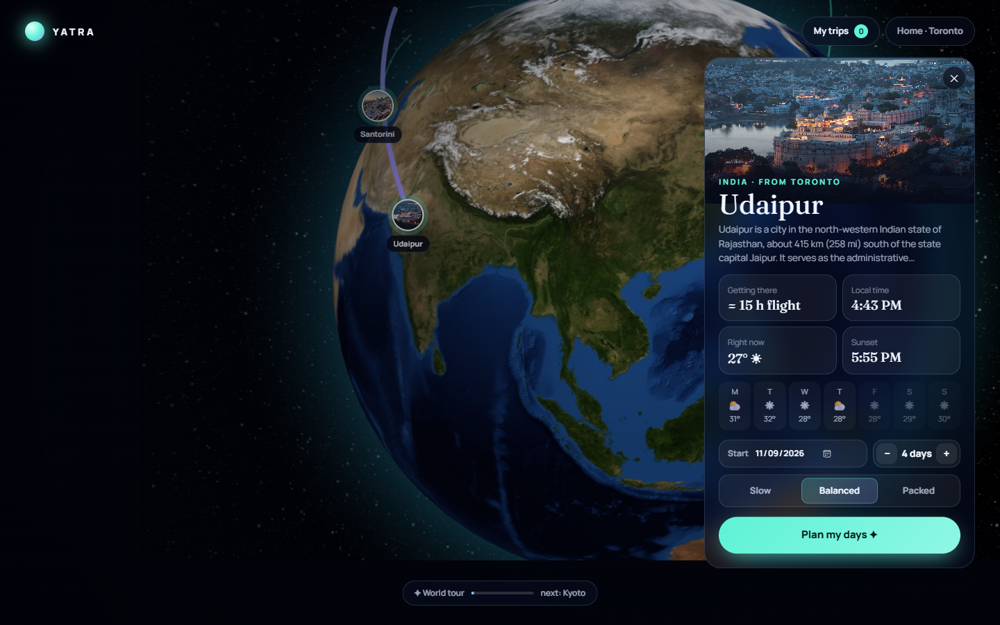

# Yatra ✦ plan less, wander more

Spin a 3D globe, pick any city on Earth, and get a day-by-day trip plan built around your pace, the weather and golden hour.

**Live demo:** https://hanee2907.github.io/yatra/



## What it does

- **A living globe.** Flight arcs glow out from home (Toronto), photo pins sit on real cities, the headline keeps changing, and a world tour drifts from place to place until you touch it.
- **Any city, live.** Search anywhere. The card shows a Wikipedia photo and summary, local time, current weather, today's sunset, a flight estimate and the week ahead.
- **A real planner, not a list.** Pick a start date, 1 to 10 days and a pace (slow, balanced, packed), then:
  1. Ranks nearby places from Wikipedia and drops schools, stations and near-duplicates.
  2. Groups them into days by area with **balanced k-means**, so no day has 7 stops while another has 1.
  3. Gives **rainy days the indoor places** (museums, palaces, temples) using the 16-day forecast.
  4. Orders each day into a short route (**nearest neighbour + 2-opt**).
  5. Schedules it: walk short hops, ride long ones, lunch around 12:30, and a lake, fort or viewpoint **saved for golden hour**.
  6. Adds an indoor **Plan B** next to outdoor stops when rain is likely.
- **Dark route map.** Every day gets its own colour, with photo pins you can click.
- **Swap any stop** and the plan rebuilds. Change pace and it re-plans instantly.
- **Smart packing list** built from the forecast and the kind of places you'll visit.
- **Save and share.** Trips save on your device, and the URL holds the whole plan, so a link opens the same trip for anyone.

## Built with

TypeScript · Vite · globe.gl (three.js) · MapLibre GL · Vitest

Free, key-less data: Wikipedia (places, photos, summaries), Open-Meteo (forecast, sunrise, sunset, time zone), Photon / OpenStreetMap (city search), OpenFreeMap (map tiles).

## Run it

```bash
npm install
npm run dev
npm test
```

The planner (`src/planner.ts`) is pure functions with unit tests for ranking, clustering, routing, scheduling, rain handling and packing.

Places and opening hours come from open data, so check before you go.
